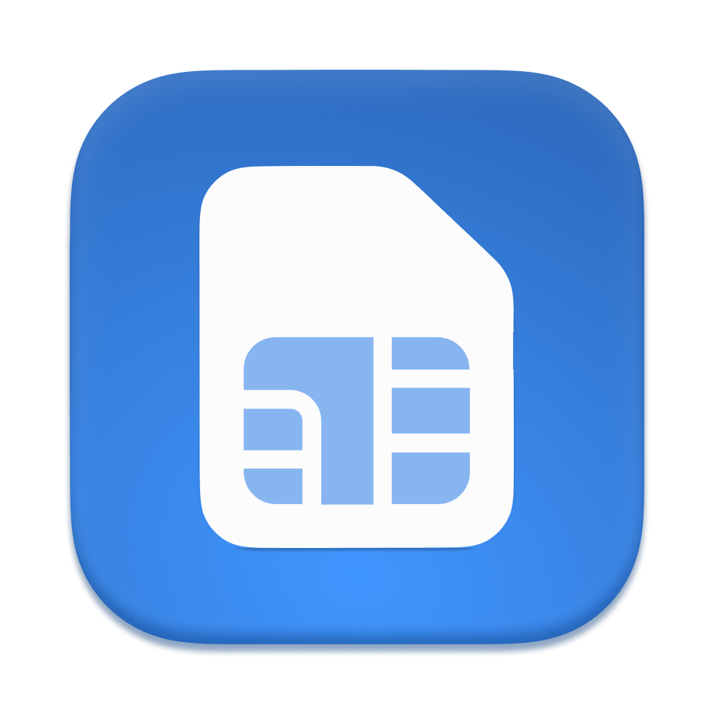
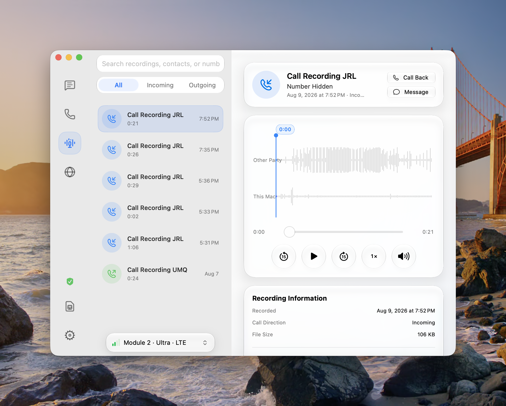

[English](README.md) · [简体中文](README.zh-CN.md)

<p align="center">
  
</p>

<h1 align="center">CellDock</h1>

<p align="center">
  在 Mac 上使用蜂窝网络、短信和电话。
</p>

<p align="center">
  <sub>界面预览 · 点击图片查看原图</sub>
</p>

> 截图用于展示界面，可能来自早于下方源码版本的构建。

| 短信 | 电话 |
| :---: | :---: |
| <a href="screenshot/1. sms.png"></a> | <a href="screenshot/2. call.png"></a> |


| 录音 | 代理 |
| :---: | :---: |
| <a href="screenshot/3.records.png"></a> | <a href="screenshot/4. proxy.png"></a> |

| 设备 | 设置 |
| :---: | :---: |
| <a href="screenshot/5. device.png"></a> | <a href="screenshot/6. settings.png"></a> |

CellDock 是一款原生 macOS 菜单栏应用，用于连接 QDC507 蜂窝模组。插入模组后，
你可以直接在 Mac 上使用蜂窝网络、收发短信、管理通讯录、拨打电话、保存通话录音，
或把指定模组的蜂窝连接作为 SOCKS5 代理共享，无需浏览器服务或额外的通信软件。

## 项目状态

当前源码中的版本信息为 **0.6.0 (96)**，支持 macOS 14 或更高版本。应用构建目标为
Apple Silicon；内置 VoWiFi runtime 同时支持 Universal 2（`arm64` 与 `x86_64`）。设备
功能取决于模组固件、SIM/eSIM、运营商开通状态和当地网络条件；一种环境中的验证结果
不代表其他环境也能正常工作。

当前仓库发布的是源代码，GitHub Releases 中尚未附带签名安装包。按下方说明构建的社区版
归档包未经 Apple 公证。

## 主要功能

### 多模组与蜂窝网络

- 同时发现并监测多个受支持的 USB 蜂窝模组。
- 通信模组和上网模组可分别选择；同一时间只有一个模组作为系统的蜂窝优先出口。
- 每个模组可设为“蜂窝优先”“保持连接”或“关闭”；保持连接的模组可继续供绑定的
  SOCKS5 代理使用，但不会成为 macOS 的默认网络出口。
- 开启后自动让蜂窝网络优先于 Wi-Fi。
- 关闭后恢复原来的网络顺序，不影响短信和来电接收。
- 每个模组分别保存蜂窝网络开关状态；同一模组重新连接时恢复之前的选择。
- ECM 链路、DHCP 或模组重启异常时执行有边界的自动恢复。
- 实时显示运营商、网络制式、信号强度、IP 地址和连接阶段。
- 可选在菜单栏以固定宽度、上下两行显示实时下载和上传速度，默认关闭。

### SOCKS5 代理

- 为不同模组分别创建 SOCKS5 代理，让应用或局域网设备选择具体的蜂窝出口。
- 可仅监听本机，也可监听局域网；端口从 `1080` 起自动分配并可修改。
- 支持无认证和用户名/密码认证；局域网监听必须配置认证。
- 每个代理可独立启停，并显示连接数、模组离线、蜂窝网络关闭、链路中断或端口占用等
  运行状态。
- 代理绑定稳定的模组身份；模组重新插入后会重新解析网络接口。认证密码保存在 macOS
  钥匙串中。

> 局域网代理会把蜂窝出口开放给同一网络中的其他设备。请使用强密码，并确认本机防火墙
> 和所处网络可信。

### 短信

- 后台接收短信并发送 macOS 通知。
- 按会话查看完整短信，复制正文、回复或新建短信。
- 发送中文短信和长短信。
- 自动识别验证码，点击即可复制并标记已读。
- 短信记录标注来源模组；可在不同可用模组之间选择发送目标。
- 删除后不再出现在 CellDock；如果短信仍保存在模组中，CellDock 会同时尝试清理。
- 可选在验证码短信已读 30 分钟后自动删除。

### 电话与录音

- 拨号、接听、拒接、静音和挂断。
- 来电时显示带“接听”和“拒接”按钮的通知与浮窗。
- 通话中提供数字拨号盘，可操作客服语音菜单。
- 使用 Mac 的麦克风和扬声器进行通话。
- 保存最近通话与未接来电，并记录通话所使用的模组。
- 支持手动录音和经用户确认后自动录音，录制双方声道并保存为 M4A。
- 录音库支持波形、播放、跳转、倍速、音量、重命名、导出和在访达中显示。

> 使用通话录音前，请先取得通话参与者同意，并遵守所在地法律法规。

### SIM、eSIM 与通讯录

- 查看 SIM 状态、ICCID、IMSI、本机号码、运营商、网络制式和信号信息。
- 分别配置每个模组是否接收来电；需要重启模组的操作会明确提示。
- 自动识别物理 SIM 与 eUICC。
- 对受支持的 eUICC 查看 EID 和套餐，并可下载、启用、停用、重命名或删除 eSIM 套餐。
- 读取 macOS 系统通讯录，匹配短信与来电姓名。
- 在 CellDock 中新建、编辑、删除联系人和管理联系人分组。

### 菜单栏、声音与界面

- 支持模组热插拔，无需重启应用。
- 菜单栏图标显示通话、未接来电、未读短信、当前上网模组或可通话模组状态。
- 菜单栏面板按模组显示未读短信和未接来电；没有待处理内容时自动隐藏对应区块。
- 可自定义短信提示音和来电铃声；默认使用 `bleeps.wav` 与 `ring.mp3`。
- 支持简体中文、English、日本語和 Français，可在设置中即时切换。
- 支持跟随系统、浅色和深色主题。
- 演示隐私保护可隐藏联系人、号码、短信正文、验证码和录音标题。
- 可打开标准主窗口；关闭窗口后继续在菜单栏运行。
- 可选择模组未插入时隐藏菜单栏图标。
- 可选择登录 Mac 时自动启动，默认关闭。

## 兼容性与限制

- 需要 macOS 14 或更高版本；当前应用构建面向 Apple Silicon。
- 项目主要面向 QDC507 蜂窝模组。其他 USB 蜂窝模组的接口和功能可能不同。
- 语音、短信、数据、实体 SIM 与 eSIM 功能受模组固件、运营商开通状态、SIM/eSIM
  套餐状态和当地网络支持影响。
- eSIM 操作和模组侧设置可能影响通信服务。请先阅读操作提示，并准备可用的替代网络连接。
- 需要兼容模组和有效蜂窝服务才能进行硬件验证；源码构建成功不代表通话、短信或运营商
  功能已经通过验证。

## 从源码构建

### 环境要求

- macOS 14 或更高版本，安装 Xcode Command Line Tools 和 Swift 6.0 或更新版本。
- Go 1.26.3，用于构建内置 VoWiFi runtime（版本记录在
  `ThirdParty/vowifi-go/go.mod`）；Go 依赖已随仓库提供。
- 需要证书支持的代码签名身份才能生成社区版归档包。仓库不包含签名证书或私钥。

### 构建与检查

```sh
git clone https://github.com/Nathanielguo/celldock-for-mac-community.git
cd celldock-for-mac-community
scripts/run_tests.sh

CELLDOCK_SIGNING_MODE=community \
CELLDOCK_CODESIGN_IDENTITY="<钥匙串中的证书名称>" \
scripts/build_app.sh
```

构建脚本会验证签名后的应用包，并把 ZIP 归档写入 `outputs/`。社区版归档未经 Apple
公证，首次打开时 macOS 可能显示安全提示。构建产物和 Go 编译缓存不会提交到 Git。

安装构建生成的归档包时，先解压，再把应用路径交给安装脚本：

```sh
CELLDOCK_INSTALL_DIR="$(mktemp -d /tmp/celldock-install.XXXXXX)"
ditto -x -k outputs/CellDock-0.6.0-arm64-community-unnotarized.zip "$CELLDOCK_INSTALL_DIR"
CELLDOCK_APP_SOURCE="$CELLDOCK_INSTALL_DIR/CellDock.app" scripts/install_app.sh
```

安装脚本会把已有的 CellDock 应用保留为带时间戳的备份。首次启动时，CellDock 可能会请求
管理员授权以安装特权网络辅助程序；该辅助程序会为蜂窝优先和代理功能修改 macOS 网络配置。

## 项目结构

| 路径 | 用途 |
| --- | --- |
| `Sources/CellDock` | 原生 macOS 应用 |
| `Sources/CellDockNetworkHelper` 与 `Sources/CellDockNetworkIPC` | 特权网络辅助程序及 IPC 协议 |
| `Sources/CModemBridge`、`Sources/CUACProbe`、`Sources/CEuiccCore` | USB 模组、音频和 eSIM 接口 |
| `ThirdParty/vowifi-go` | VoWiFi runtime 源码与 vendored Go 依赖 |
| `Resources` | 应用元数据、本地化、提示音、图标及模组语音载荷源码 |
| `Tests` 与 `scripts/run_tests.sh` | 本地自测与验证工具 |
| `docs` | 安全说明、模组报告与第三方许可证声明 |

## 问题反馈

提交问题时，请说明 macOS 版本、模组型号与固件、运营商以及复现步骤。分享日志前请移除
电话号码、IMEI/ICCID/IMSI、短信内容、APDU 数据、账号信息和网络凭据。不要附上代码签名
证书或私钥。

## 鸣谢

特别感谢 [moluncn/mavo](https://github.com/moluncn/mavo) 项目。CellDock 在界面与功能设计上参考了 mavo，得益于原作者的开源工作，特此鸣谢。

## 免责声明

- CellDock 按“现状”提供，不附带任何明示或默示的担保，作者不对其适用性或特定用途表现作任何保证。
- 本软件会修改 macOS 的网络配置（例如将蜂窝网络设为优先出口、安装网络辅助组件），可能影响既有网络连接，使用前请确认了解相关功能。
- 蜂窝网络、短信、电话与 eSIM 等功能的可用性受模组固件、SIM 卡、运营商及当地网络环境影响，作者不保证其在所有环境下的可用性或表现。
- 将蜂窝连接通过 SOCKS5 代理共享给局域网设备，会将该网络出口暴露给同一网络中的其他设备，请自行评估安全风险并妥善配置认证。
- 通话录音前请取得通话参与者的同意，并遵守所在地法律法规；使用蜂窝共享等功能时也请遵守运营商的服务条款。
- 因使用或无法使用本软件而造成的任何直接或间接损失，作者均不承担责任。

## 许可证

CellDock 应用代码使用[非商业使用许可](LICENSE)：个人和非商业用途可免费使用、
修改与分发；**禁止任何形式的商业使用**，商业使用需另行获得作者书面授权。
第三方组件及其许可证说明见 [THIRD_PARTY_NOTICES.md](docs/THIRD_PARTY_NOTICES.md)。
